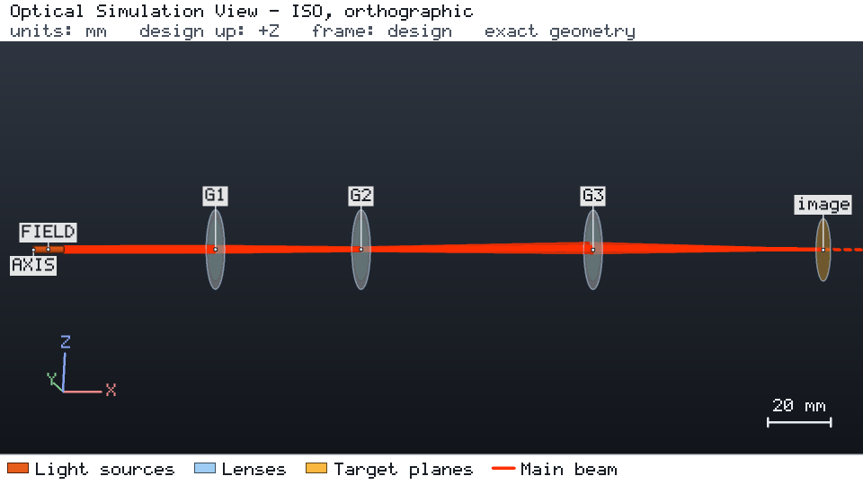
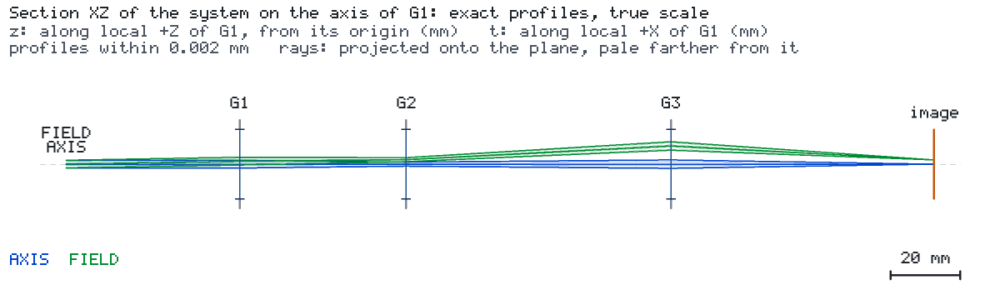
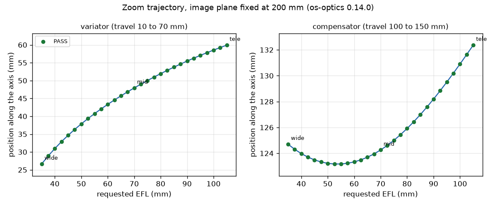
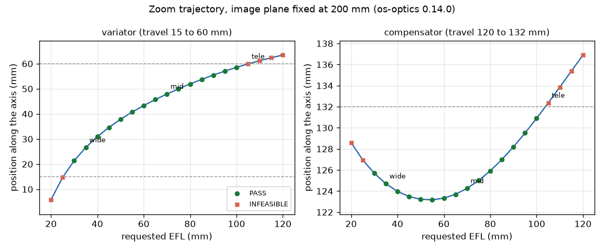

# Three-group zoom with a fixed image plane

[简体中文](README.zh-CN.md) · [Agent case sheet](CASE.md)

Three ideal thin lenses form a 35-105 mm zoom for a collimated 633 nm beam. The front group G1 (f = 100 mm) stays
at x = 0, the variator G2 (f = −30 mm) changes the focal length and the compensator G3 (f = 50 mm) keeps the image
on a plane fixed at x = 200 mm. `os-optics-kit zoom` finds both moving positions for every focal length of a range
and writes them as named configurations of one Project that the engine runs and the kit viewer shows.





Both images are the engine's browser-free snapshots of a run of `project.json` (the 70 mm position):
`os-optics view run --no-browser --snapshot DIR` with `--views iso --size 960x540`, and again with
`--section ALL --frame=scene --size 1200x420`. In a kit checkout, `os-optics-kit cases images three-group-zoom`
re-renders exactly these views as recorded in `images.json`.

## Run it

```bash
os-optics-kit cases copy three-group-zoom --dest .
cd three-group-zoom
os-optics project run project.json --out-dir run
os-optics-kit zoom studies/zoom.json --out zoom --study
os-optics-kit view zoom/project.json --configuration efl_087p50
os-optics project run zoom/project.json --out-dir zoom/run
os-optics-kit view zoom/run --configuration tele
os-optics-kit plot sweep zoom/study --y target:axis_spot
os-optics-kit compare zoom/study --out zoom/compare
python figures.py zoom --out images
```

[`studies/zoom.json`](studies/zoom.json) declares the two moving groups with their travel and mount envelopes, the
range 35-105 mm in steps of 2.5 mm, the wavelength, the image plane (observation `image`), the acceptance
tolerances (EFL ±0.01 mm, focus ±0.005 mm, clearance at least 1 mm) and three anchors: the known positions at 35,
70 and 105 mm. `zoom/` then holds `project.json` (29 configurations), `trajectory.json`, `trajectory.csv`,
`report.md` and, with `--study`, a sweep study of all 29 configurations.

## Results

The positions are solved with the engine's paraxial analysis in the loop; the achieved EFL and the focus error are
read back from the engine's paraxial analysis of `zoom/project.json`, one configuration at a time. Focus error is
the rear focal point minus the image plane along the axis (design frame); clearance is the least axial gap between
mount envelopes, here between G1's (3 mm behind it) and G2's (3 mm in front of it). Spot radius: the 1/e² radius
of the on-axis beam on the image plane in the engine run of each configuration (`--study`).

| Configuration | EFL requested (mm) | EFL achieved (mm) | G2 (mm) | G3 (mm) | Focus error (mm) | Least clearance (mm) | Spot radius (mm) | Status |
| --- | ---: | ---: | ---: | ---: | ---: | ---: | ---: | --- |
| `wide` | 35 | 35.000000 | 26.6323 | 124.7022 | −1.6e-12 | 20.632 | 0.007050 | PASS |
| `efl_045p00` | 45 | 45.000000 | 34.6509 | 123.4882 | −9.1e-10 | 28.651 | 0.009065 | PASS |
| `efl_055p00` | 55 | 55.000000 | 40.7350 | 123.1737 | −2.5e-10 | 34.735 | 0.011079 | PASS |
| `mid` | 70 | 70.000000 | 47.9331 | 124.2553 | −5.7e-13 | 41.933 | 0.014100 | PASS |
| `efl_087p50` | 87.5 | 87.500000 | 54.6221 | 127.5740 | −1.6e-11 | 48.622 | 0.017626 | PASS |
| `tele` | 105 | 105.000000 | 59.9205 | 132.3609 | −3.7e-11 | 53.921 | 0.021151 | PASS |

All 29 samples pass; the largest EFL error is 2.0e-8 mm and the largest focus error 1.8e-9 mm (both at 40 mm).
The solved anchors lie within 4.6e-5 mm of the declared positions, which are rounded to 0.1 µm. The variator moves
one way while the compensator first moves towards the front and reverses at about 53.7 mm (123.17 mm). The spot
radius follows λf / (πw₀) for the 1 mm waist at every sample, so the traced beam is focused on the fixed plane.
The test suite checks the anchors and every intermediate sample against its own thin-lens calculation.



## Constraints

[`studies/zoom_constrained.json`](studies/zoom_constrained.json) asks for 20-120 mm with tighter travel (G2 15-60 mm,
G3 120-132 mm). The solver still solves every sample; the constraints are checked on the solved positions:

```bash
os-optics-kit zoom studies/zoom_constrained.json --out constrained
python figures.py constrained --out images --name constrained.png
```

| EFL (mm) | G2 (mm) | G3 (mm) | Least clearance (mm) | Status | Reasons |
| ---: | ---: | ---: | ---: | --- | --- |
| 20 | 5.7984 | 128.5995 | −0.202 | INFEASIBLE | G2 travel (5.798 mm < 15 mm), clearance G1/G2 −0.202 mm < 1 mm |
| 25 | 14.7151 | 126.9646 | 8.715 | INFEASIBLE | G2 travel |
| 30-100 | | | ≥ 15.372 | PASS (15 samples) | |
| 105 | 59.9205 | 132.3609 | 53.921 | INFEASIBLE | G3 travel (132.361 mm > 132 mm) |
| 110-120 | 61.1963-63.4521 | 133.8598-136.9042 | ≥ 55.196 | INFEASIBLE (3 samples) | G2 and G3 travel |

The command exits 1 with 15 PASS and 6 INFEASIBLE; 70 % of the requested range lies between adjacent PASS samples
(30-100 mm). Positions outside the travel are reported as solved, not clipped, and stay in the Project as
configurations, so the viewer shows them as well.


