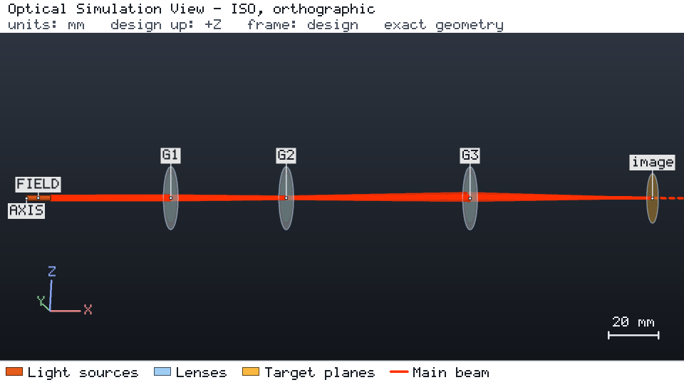
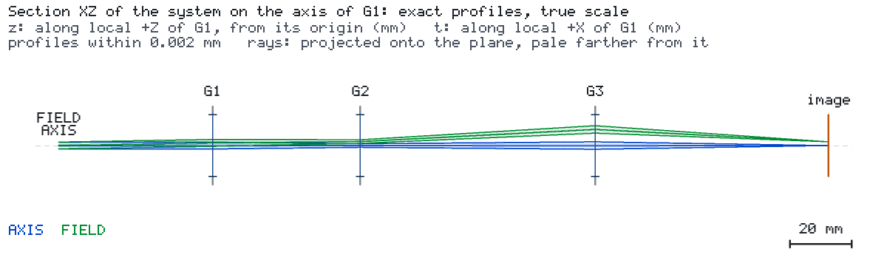
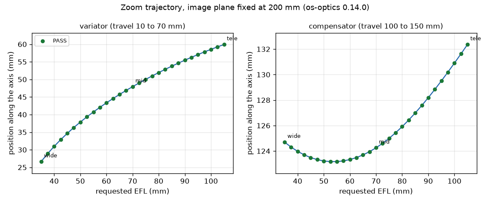
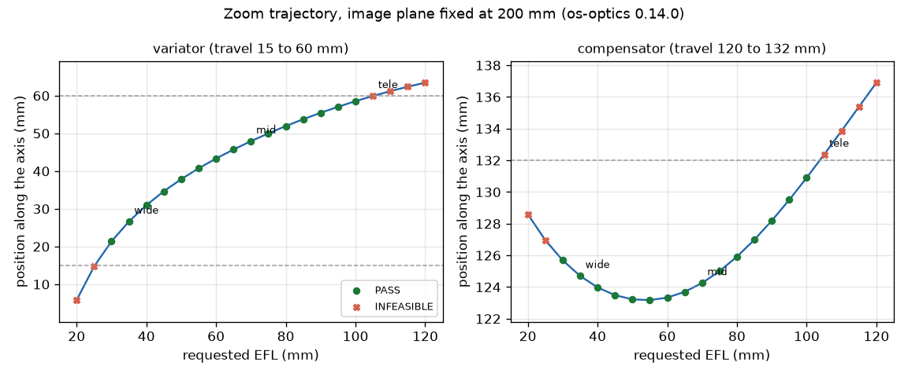

# 像面固定的三组元变焦

[English](README.md) · [智能体案例页](CASE.md)

三片理想薄透镜组成一个 35-105 mm 的变焦系统，输入为 633 nm 准直光束。前组 G1（f = 100 mm）固定在 x = 0,
变倍组 G2（f = −30 mm）改变焦距，补偿组 G3（f = 50 mm）使像始终落在固定于 x = 200 mm 的像面上。
`os-optics-kit zoom` 对焦距范围内的每个焦距求出两个运动组的位置，并把它们写成同一个 Project 的命名配置，
引擎可以直接运行，kit 查看器可以按配置查看。





两幅图都是引擎对 `project.json`（70 mm 位置）运行结果的无浏览器快照：
`os-optics view run --no-browser --snapshot DIR`，参数分别为 `--views iso --size 960x540` 和
`--section ALL --frame=scene --size 1200x420`。在 kit 仓库中，`os-optics-kit cases images three-group-zoom`
按 `images.json` 的记录重新渲染这两幅视图。

## 运行

```bash
os-optics-kit cases copy three-group-zoom --dest .
cd three-group-zoom
os-optics project run project.json --out-dir run
os-optics-kit zoom studies/zoom.json --out zoom --study
os-optics-kit view zoom/project.json --configuration efl_087p50
os-optics project run zoom/project.json --out-dir zoom/run
os-optics-kit view zoom/run --configuration tele
os-optics-kit plot sweep zoom/study --y target:axis_spot
os-optics-kit compare zoom/study --out zoom/compare
python figures.py zoom --out images
```

[`studies/zoom.json`](studies/zoom.json) 声明两个运动组及其行程和镜座包络、步长 2.5 mm 的 35-105 mm 焦距范围、
波长、像面（观测面 `image`）、验收容差（EFL ±0.01 mm，焦点 ±0.005 mm，间隙至少 1 mm）以及三个锚点：
35、70、105 mm 处的已知位置。运行后 `zoom/` 中有 `project.json`（29 个配置）、`trajectory.json`、
`trajectory.csv`、`report.md`，加 `--study` 时还有对全部 29 个配置运行的扫描研究。

## 结果

位置由以引擎近轴分析为模型的求解器求出；达到的 EFL 和焦点误差再从引擎对 `zoom/project.json` 逐个配置的
近轴分析中读出。焦点误差是沿光轴（设计坐标系）的后焦点位置减去像面位置；间隙是镜座包络之间最小的轴向距离，
这里是 G1 的包络（其后 3 mm）与 G2 的包络（其前 3 mm）之间。光斑半径是每个配置的引擎运行（`--study`）中
轴上光束在像面上的 1/e² 半径。

| 配置 | 要求 EFL (mm) | 达到 EFL (mm) | G2 (mm) | G3 (mm) | 焦点误差 (mm) | 最小间隙 (mm) | 光斑半径 (mm) | 状态 |
| --- | ---: | ---: | ---: | ---: | ---: | ---: | ---: | --- |
| `wide` | 35 | 35.000000 | 26.6323 | 124.7022 | −1.6e-12 | 20.632 | 0.007050 | PASS |
| `efl_045p00` | 45 | 45.000000 | 34.6509 | 123.4882 | −9.1e-10 | 28.651 | 0.009065 | PASS |
| `efl_055p00` | 55 | 55.000000 | 40.7350 | 123.1737 | −2.5e-10 | 34.735 | 0.011079 | PASS |
| `mid` | 70 | 70.000000 | 47.9331 | 124.2553 | −5.7e-13 | 41.933 | 0.014100 | PASS |
| `efl_087p50` | 87.5 | 87.500000 | 54.6221 | 127.5740 | −1.6e-11 | 48.622 | 0.017626 | PASS |
| `tele` | 105 | 105.000000 | 59.9205 | 132.3609 | −3.7e-11 | 53.921 | 0.021151 | PASS |

29 个样本全部通过；最大 EFL 误差 2.0e-8 mm，最大焦点误差 1.8e-9 mm（都在 40 mm 处）。求解后的锚点与声明位置
相差不超过 4.6e-5 mm（声明值取整到 0.1 µm）。变倍组单向运动，补偿组先向前移动，约在 53.7 mm（123.17 mm）
处折返。每个样本的光斑半径都符合 1 mm 束腰的 λf / (πw₀)，说明追迹光束聚焦在固定像面上。测试用例用自己的
薄透镜计算检查锚点和每个中间样本。



## 约束

[`studies/zoom_constrained.json`](studies/zoom_constrained.json) 要求 20-120 mm，并收紧行程（G2 15-60 mm，
G3 120-132 mm）。求解器仍对每个样本求解，约束在求得的位置上检查：

```bash
os-optics-kit zoom studies/zoom_constrained.json --out constrained
python figures.py constrained --out images --name constrained.png
```

| EFL (mm) | G2 (mm) | G3 (mm) | 最小间隙 (mm) | 状态 | 原因 |
| ---: | ---: | ---: | ---: | --- | --- |
| 20 | 5.7984 | 128.5995 | −0.202 | INFEASIBLE | G2 行程（5.798 mm < 15 mm），G1/G2 间隙 −0.202 mm < 1 mm |
| 25 | 14.7151 | 126.9646 | 8.715 | INFEASIBLE | G2 行程 |
| 30-100 | | | ≥ 15.372 | PASS（15 个样本） | |
| 105 | 59.9205 | 132.3609 | 53.921 | INFEASIBLE | G3 行程（132.361 mm > 132 mm） |
| 110-120 | 61.1963-63.4521 | 133.8598-136.9042 | ≥ 55.196 | INFEASIBLE（3 个样本） | G2 和 G3 行程 |

命令以退出码 1 结束，15 个 PASS、6 个 INFEASIBLE；要求范围的 70 % 位于相邻 PASS 样本之间（30-100 mm）。
超出行程的位置按求解结果报告，不截断，并作为配置保留在 Project 中，查看器同样可以显示。


